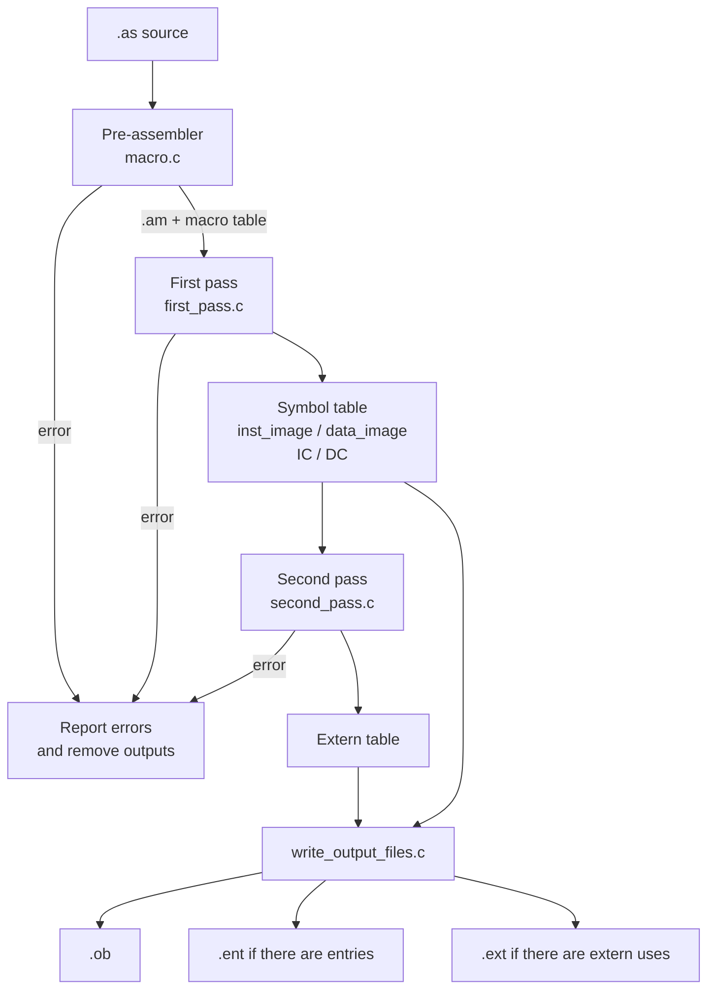

# Assembler

[](https://en.wikipedia.org/wiki/ANSI_C)

A two-pass assembler in standard C for an imaginary 32-bit machine. This was my final project (**Maman 14**) for the Open University of Israel course **20465**, the systems programming lab, in semester 2026B. I scored 98

It translates assembly source into machine-code object files. It does not link, load, or run the program. The code uses only the C standard library with no external libraries

## What it does

Given one or more `.as` files, the assembler:

1. Expands `mcro` / `mcroend` macros into an intermediate `.am` file
2. Walks that file twice: first to build a symbol table and encode what it can, then to resolve labels, entries, and external uses
3. Writes a `.ob` object file, plus `.ent` and `.ext` when they are needed

Instructions are 32-bit words in R, I, or J format, stored little-endian, and assembled to load at address **100**. The machine has 32 registers, `$0`–`$31`. Supported directives are `.db`, `.dh`, `.dw`, `.asciz`, `.entry`, and `.extern`.

If a file has errors, the assembler prints them with line numbers and does not leave output for that file.

## How it works



The modules follow that pipeline:

- **Pre-assembler** (`macro.c`, `macro_helpers.c`) — stores each macro body in a linked `Macro` / `Line` list, then writes the expanded `.am` file.
- **First pass** (`first_pass.c`, `first_pass_helper.c`, `classifier.c`) — classifies each line, parses operands, and fills a linked `Symbol_table`. Instructions go into `inst_image` as 32-bit words; data goes into `data_image` as bytes. `IC` starts at 100 and grows by 4 per instruction; `DC` counts data bytes. After the pass, data symbols are relocated by the final `IC`. An `Operation` table in `first_pass_helper.c` maps all 27 instructions to an opcode, funct, format (`R` / `I` / `J`), and operand pattern. `encoder_r`, `encoder_i`, and `encoder_j` pack the bits.
- **Second pass** (`second_pass.c`, `second_pass_helper.c`) — fills in branch distances and jump addresses, marks `.entry` symbols, and records external uses in an `Extern_table`.
- **Output** (`write_output_files.c`) — writes `.ob` always on success, and `.ent` / `.ext` only when they have content. On failure, `main.c` removes `.am`, `.ob`, `.ent`, and `.ext` for that file.

## Project structure

| File | Role |
|------|------|
| `main.c` | Command line and pipeline |
| `macro.c`, `macro_helpers.c` | Macro expansion |
| `first_pass.c`, `first_pass_helper.c` | First pass, parsing, encoding, symbol table |
| `second_pass.c`, `second_pass_helper.c` | Label resolution, entries, extern uses |
| `classifier.c` | Line and directive classification |
| `write_output_files.c` | `.ob` / `.ent` / `.ext` writers |
| `header_files/datatypes.h` | `Symbol`, `Macro`, `Operation`, and the tables |
| `header_files/constants.h` | Limits and numeric ranges |
| `makefile` | Build |
| `tests/` | Sample inputs and the outputs they produced |

## Build

```bash
make
```

This builds the `assembler` executable with `gcc -ansi -pedantic -Wall -Iheader_files`.

## Run

Pass source file names **with** the `.as` extension. You can pass more than one file:

```bash
./assembler tests/example_external.as
./assembler tests/example_valid.as tests/test1.as
```

Output files are written next to the source, using the same base name.

## Examples

### A complete valid program

From `tests/example_external.as`:

```asm
.extern PRINT
.entry MAIN
MAIN: move $5,$6
andi $5,255,$7
beq $5,$7,END
call PRINT
END: hlt
NUMBERS: .db -128,0,127
.dh -32768,32767
.dw -2147483648,2147483647
```

`tests/example_external.ob` — the first line is the code size and data size in bytes. Each following line starts with a **decimal** address (four digits) and the stored bytes in little-endian hex:

```
20 15
0100 40 30 A0 04
0104 FF 00 A7 30
0108 08 00 A7 40
0112 00 00 00 80
0116 00 00 00 FC
0120 80 00 7F 00
0124 80 FF 7F 00
0128 00 00 80 FF
0132 FF FF 7F
```

`tests/example_external.ent`:

```
MAIN 0100
```

`tests/example_external.ext` — `PRINT` is used at address 112:

```
PRINT 0112
```

A larger example, with more instructions, macros, entries, and externs, is in `tests/test1.as` and its matching `.ob`, `.ent`, and `.ext` files.

### Macros

From `tests/example_valid.as`, a macro is defined and then called by name. The expanded source is in `tests/example_valid.am`:

```asm
mcro LOAD_DONE
la VALUE
jmp DONE
mcroend

START: add $1,$2,$3
addi $3,-10,$4
LOAD_DONE
DONE: hlt
```

becomes:

```asm
START: add $1,$2,$3
addi $3,-10,$4
la VALUE
jmp DONE
DONE: hlt
```

### Errors

`tests/example_errors.as` collects illegal lines: a duplicate label, an out-of-range register, a missing operand, an unknown directive, and other malformed input. The assembler reports each problem with a line number. This repository does not include a saved copy of that console output. When a file fails, any `.am`, `.ob`, `.ent`, or `.ext` for that file is removed.
