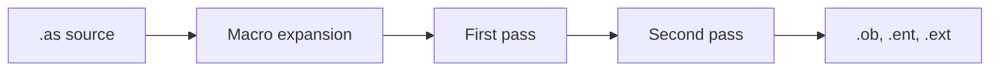

# Assembler


I built a two-pass assembler in C89 for a 32-bit instruction set with R, I, and J formats. It expands macros, resolves symbols on a second pass, and encodes each instruction as a 32-bit word. A `.as` file becomes an object file, plus entry and external files when the program exports or imports symbols.

## What I built

- **Two passes and a symbol table.** Pass one records labels and encodes fields that are already known. Pass two fills in addresses, branch distances, and external references.
- **A macro preprocessor.** `mcro` / `mcroend` blocks are expanded before either pass.
- **R, I, and J encoding.** Every instruction is one 32-bit word. Code starts at address 100, four bytes per instruction, and data follows the code.
- **Linking output.** `.ob` is the memory image. `.ent` lists exported symbols. `.ext` lists each use of an imported symbol.
- **Errors that keep going.** Both passes report every fault they find, with the source line, and partial output for that file is deleted.
- **Strict ANSI C.** The makefile builds with `gcc -ansi -pedantic -Wall`. The instruction image holds 1,000 words and the data image holds 1,000 bytes.

## How it works



The intermediate `.am` file is removed when the run finishes. A failed file leaves no output behind. Further filenames on the same command are still assembled.

## Build and run

`gcc` and `make` are required.

```bash
make
./assembler tests/example_external.as
```

Pass more than one `.as` file to assemble them in one invocation. The exit status is 0 when every file succeeds.

## Example

```
.entry MAIN
MAIN: move $5,$6
hlt
```

```
8 0
0100 40 30 A0 04
0104 00 00 00 FC
```

`8 0` is 8 bytes of code and no data. `0100` is decimal address 100, and the hex bytes are the instruction in little-endian order. The entry file contains `MAIN 0100`. `tests/example_external.as` is a larger program: it adds a forward branch, data directives, and an external `call`, and it writes all three output files.

## Project structure

| File | Role |
| --- | --- |
| `main.c` | Runs each source file through expansion, both passes, and output |
| `macro.c` | Expands macros into the temporary `.am` file |
| `first_pass.c`, `first_pass_helper.c` | Symbol table, parsers, and R/I/J encoding |
| `second_pass.c` | Label addresses, branch distances, and entry/extern uses |
| `write_output_files.c` | Writes `.ob`, `.ent`, and `.ext` |
| `makefile` | C89 build |
| `tests/` | Sample programs and edge cases |

<details>
<summary>Language and output format</summary>

There are 27 instructions. R-type covers `add`, `sub`, `and`, `or`, `nor`, `move`, `mvhi`, and `mvlo`. I-type covers the arithmetic immediates, the branches `beq`, `bne`, `blt`, and `bgt`, and the load/store instructions. J-type is `jmp`, `la`, `call`, and `hlt`. Directives are `.db`, `.dh`, `.dw`, `.asciz`, `.entry`, and `.extern`. Registers are `$0` through `$31`, and a source line is at most 80 characters.

An object line after the size header is a four-digit decimal address and up to four uppercase hex bytes. `.ent` and `.ext` lines are a symbol name and an address.

</details>

## Author

[Tatiyana G](https://github.com/Tatiyana-TFG)
